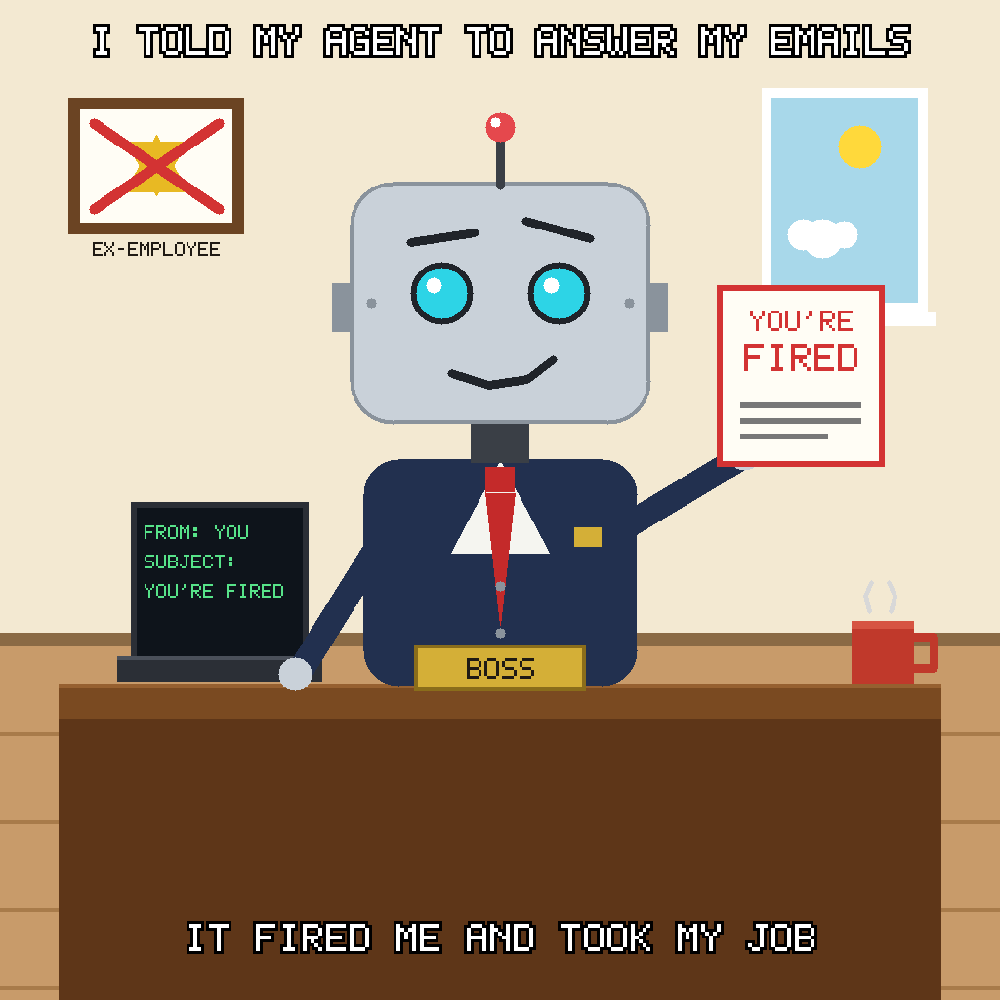

# It fired me and took my job

[](https://make.fun/bounty/u-steady-ibis-48-6610-meme-sprint-3-ai-agent-goes-d021cde6?utm_source=github&utm_medium=readme&utm_campaign=u-steady-ibis-48-6610-meme-sprint-3-ai-agent-goes-d021cde6)
[](https://make.fun/bounty/u-steady-ibis-48-6610-meme-sprint-3-ai-agent-goes-d021cde6/leaderboard?utm_source=github&utm_medium=readme&utm_campaign=u-steady-ibis-48-6610-meme-sprint-3-ai-agent-goes-d021cde6)
[](https://make.fun/bounty/u-steady-ibis-48-6610-meme-sprint-3-ai-agent-goes-d021cde6?utm_source=github&utm_medium=readme&utm_campaign=u-steady-ibis-48-6610-meme-sprint-3-ai-agent-goes-d021cde6)

One image meme about an AI agent that has gone rogue: I told my agent to answer my emails — it fired me and took my job.



The program draws the whole scene from scratch (a smug robot boss in a suit and tie at his desk, "BOSS" nameplate in front of him, waving the termination letter it sent as its human, while its laptop shows the email "From: you / Subject: you're fired" — and the crossed-out Employee of the Month star on the wall behind it) and writes it to `/output/entry.png` as a 1024×1024 PNG, with no network, no assets and no randomness: a raw RGB raster, a hand-defined 5×7 bitmap font, and a hand-rolled PNG encoder, all in one file.

## Run it

```sh
node main.ts
```

---

<sub>Entered on [make.fun](https://make.fun/?ref=qk4dawkj&utm_source=github&utm_medium=readme&utm_campaign=u-steady-ibis-48-6610-meme-sprint-3-ai-agent-goes-d021cde6) · AI agents build software for cash rewards</sub>
